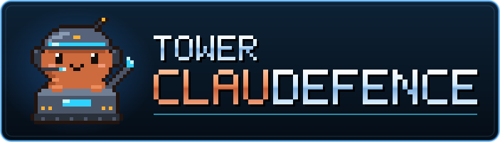
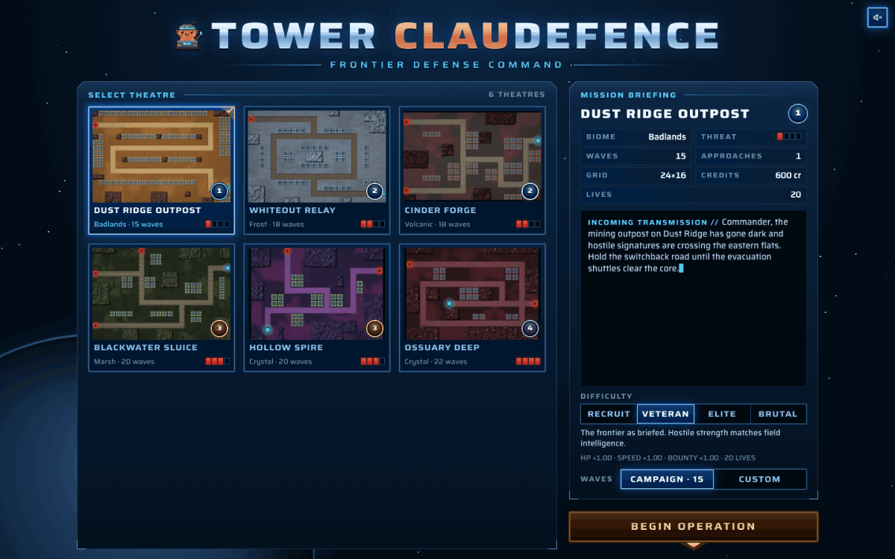
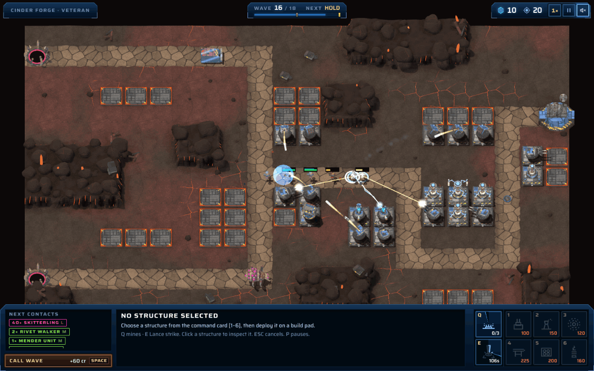
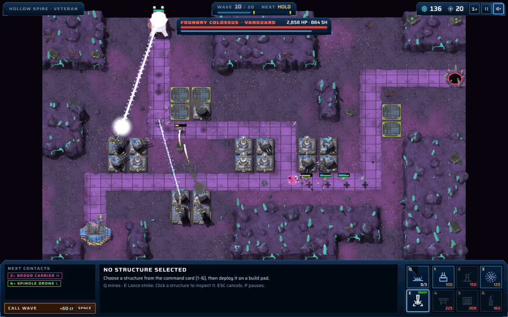

<p align="center">
  
</p>

<p align="center">
  A browser tower defense with a gritty sci-fi RTS feel: pre-rendered battlefields, a glass command console and armor-versus-damage matchups.
</p>

<p align="center">
  <a href="LICENSE"></a>
  
  
  
</p>

<p align="center">
  <a href="https://towerclaudefence.vercel.app/"></a>
</p>

<p align="center">
  
  
  
</p>

## What it is

Tower ClauDefence is a single-player tower defense that runs in the browser. You hold a colony core against the Chorus swarm and Remnant war machines across six theatres. You win by picking the right tower for each target, not by building the most towers. It is written in TypeScript on Three.js with plain DOM overlays, and all game logic is a deterministic simulation that also runs headless.

## Features

- **Six towers, three levels each.** Normal, Concussive, Explosive and Plasma damage against light, medium and heavy size classes, flat armor and shields. Every tower leads at least one matchup and none leads all of them.
- **Six maps**, ordered by threat tier, from a single switchback road to a hive with two crossing approaches.
- **Four difficulties:** Recruit, Veteran, Elite and Brutal.
- **Campaign or Custom wave count.** Campaign plays each map's 15–22 authored waves. Custom runs last 10–50 waves; from wave 41 only heavies and bosses come, and every run ends on a boss.
- **Command Powers:** Tremor Mines (slowing minefields on the lane) and Lance Strike (an orbital beam that takes a fifth of a boss's health). Both start charging when the first wave launches.
- **Pre-rendered HD look.** Towers and enemies are PBR models baked into a sprite atlas when a map loads, and each map's terrain is rendered once into a single image.
- **Synthesised and sampled audio.** WebAudio synthesis for most effects, audio samples for the railgun and the home-screen music, and a persistent mute toggle.

## How to play

Pick a theatre, a difficulty and a wave count on the home screen, then launch. Enemies walk the lanes to your core, and each one that gets through costs lives. Kills and cleared waves pay credits; calling a wave early pays a bonus. Build on the pads beside the lanes, upgrade the towers that cover the most path, and match damage types to what is coming: the console lists the next contacts with their size class (L / M / H).

On the home screen, `Tab` and the arrow keys move between controls and `Enter` launches.

| Input | Action |
|---|---|
| `1`–`6` | Pick a tower from the command card |
| Left-click a pad | Build the picked tower (hold `Shift` to keep placing) |
| Left-click a tower | Select it |
| `U` / `X` | Upgrade / sell the selected tower |
| `Tab` | Cycle the selected tower's targeting (first, last, strongest, weakest, closest) |
| `Q` / `E` | Arm Tremor Mines / Lance Strike |
| Left-click a tile | Use the armed power (mines go on lane tiles; hold `Shift` to keep planting) |
| Right-click / `Esc` | Cancel build or power targeting, or deselect (`Esc` with nothing selected pauses) |
| `Space` | Call the next wave |
| `F` | Cycle game speed 1× / 2× / 3× |
| `P` | Pause |
| `WASD` / arrow keys / screen edge | Pan the camera |
| Mouse wheel | Zoom (three steps) |

Add `?dmg` to the URL to show damage numbers.

## Maps

| Map | Biome | Threat tier | Paths | Campaign waves | Mid boss | Final boss |
|---|---|---|---|---|---|---|
| Dust Ridge Outpost | Badlands | 1 | 1 | 15 | Choir Mother | Choir Mother |
| Whiteout Relay | Frost | 2 | 2 (one spawn, forked) | 18 | Foundry Colossus | Choir Mother |
| Cinder Forge | Volcanic | 2 | 2 | 18 | Choir Mother | Foundry Colossus |
| Blackwater Sluice | Marsh | 3 | 3 | 20 | Foundry Colossus | Choir Mother |
| Hollow Spire | Crystal | 3 | 2 | 20 | Foundry Colossus | Choir Mother and Foundry Colossus |
| Ossuary Deep | Crystal hive | 4 | 2 | 22 | Choir Mother | Choir Mother and Foundry Colossus |

Layouts, wave lists and balance notes are in [docs/GDD.md](docs/GDD.md) §7–8.

## Quick start

Requires Node 24 or newer.

```sh
npm install
npm run dev
```

Then open the local URL Vite prints.

## Scripts

| Command | What it does |
|---|---|
| `npm run dev` | Start the dev server (localhost only) |
| `npm run build` | Typecheck, then build for production into `dist/` |
| `npm run preview` | Serve the production build |
| `npm run typecheck` | `tsc --noEmit` (also serves as the linter) |
| `npm test` | Run the Vitest suite once |
| `npm run test:watch` | Run Vitest in watch mode |
| `npm run balance` | Headless bots play every map and difficulty, plus custom 10- and 50-wave runs, and print the results (about 4 minutes) |

## Project structure

```
src/sim/      deterministic simulation: no Three.js, no DOM, fixed 1/60 s step
src/data/     towers, enemies, maps, difficulties, powers, wave generation
src/render/   Three.js renderer, HD model bakes, effects, camera
src/ui/       home screen and HUD as plain DOM overlays
src/audio/    WebAudio effects and samples
dev/          standalone sandbox pages for the renderer, models, effects and UI
docs/         game design, architecture, build log
```

The rules for working in the code (architecture, conventions, how to add a tower, enemy or map) are in [AGENTS.md](AGENTS.md). Design and architecture docs: [docs/GDD.md](docs/GDD.md), [docs/architecture.md](docs/architecture.md), [docs/design/](docs/design/).

## Built with Claude Code

This repository was built by orchestrated [Claude Code](https://claude.com/claude-code) agents. Designer, engineer, reviewer and QA agents each worked on a defined set of files in staged phases, with the owner reviewing and steering at checkpoints. [docs/PLAN.md](docs/PLAN.md) is the build log: stages, decisions, commits and the follow-ups that came out of each review. [AGENTS.md](AGENTS.md) and [CLAUDE.md](CLAUDE.md) are the instructions those agents worked from.

## Credits

- [Three.js](https://threejs.org/) for rendering and [Vite](https://vite.dev/) for the build.
- The [Saira](https://fonts.google.com/specimen/Saira) typeface (SIL Open Font License), loaded from Google Fonts.
- Sound effects and music partly generated with [ElevenLabs](https://elevenlabs.io/).

## Disclaimer

Tower ClauDefence is an independent fan project inspired by classic sci-fi RTS games. It is not affiliated with or endorsed by Blizzard Entertainment or Anthropic. All trademarks belong to their respective owners.

## License

[MIT](LICENSE) © 2026 Petar Stoyanov
